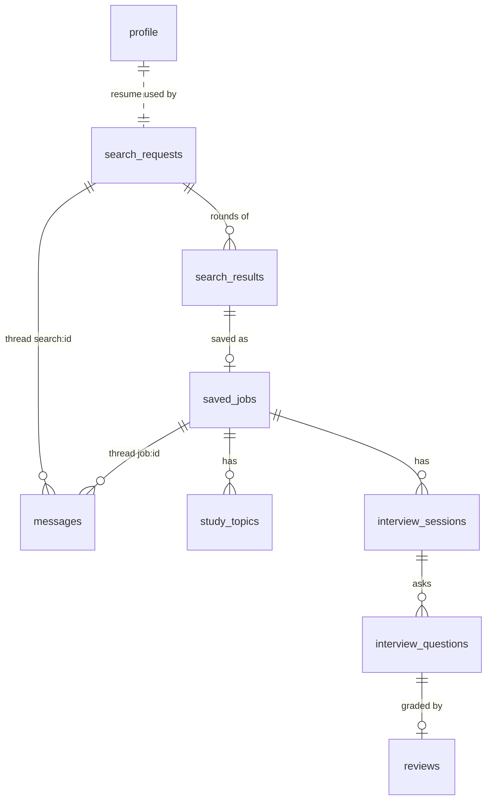

# Mentor AI — Database

One SQLite file at `data/mentor.db` (git-ignored), created on startup by `db.init_db()`. Columns added after v1.0
(`MIGRATIONS` in `db.py`) are added to existing databases automatically. One user, no accounts.
The schema lives in `backend/db.py` (`SCHEMA`); this page explains it.



## Tables

### `profile` — the resume (always one row, `id = 1`)
| Column | Notes |
|---|---|
| `resume_path` | `data/uploads/resume.<ext>` — the file itself is sent to Gemini on each call |
| `resume_mime` | `application/pdf`, `image/png`, `image/jpeg`, or `text/plain` |
| `resume_filename` | Original name, shown in the resume bar |

### `messages` — the Summary Agent's conversations
| Column | Notes |
|---|---|
| `thread` | `search:<request id>` or `job:<saved job id>` |
| `role` | `user`, `feedback` (on job results), or `summary` |
| `content` | Markdown-ish text |

### `search_requests` — one job search conversation
| Column | Notes |
|---|---|
| `status` | See *Job search status* below |
| `understanding_json` | Latest `JobPreferences` from the Summary Agent |
| `round` | Search rounds run so far (feedback starts a new round) |
| `error` | Friendly error when `status = failed` |

### `search_results` — every post shown to the user
| Column | Notes |
|---|---|
| `request_id`, `round` | Which search and which round |
| `title`, `company`, `location`, `level`, `url`, `source`, `posted_date` | `url` is empty if it was not in the search results; `posted_date` may be `unknown` |
| `job_description` | Full text as found |
| `summary`, `why_relevant` | Written by the Summary Agent |
| `fit_score` | 0–100 from the Web Search Agent's ranking (+ code nudges); results are stored best first |
| `status` | `shown` or `saved`. Shown posts are passed back so later rounds skip them |

### `saved_jobs` — the Saved Jobs tab
| Column | Notes |
|---|---|
| Job fields | Copied from `search_results` (incl. `fit_score`); `job_description` is a summary from search and can be replaced by pasting the full post |
| `study_status` | `not_started → studying → done` |
| `interview_status` | `not_started → started → done` |
| `study_message` | The Summary Agent's study plan message |

### `study_topics` — what the interview will test
| Column | Notes |
|---|---|
| `name`, `why_needed`, `resume_evidence` | From the Summary Agent |
| `self_rating` | 1–5 from the user |
| `priority` | `study_first` or `review_later` |
| `plan` | Concrete study actions |
| `status` | `not_started → studying → done` (per-topic checkbox) |

### `interview_sessions` — one mock interview attempt
| Column | Notes |
|---|---|
| `status` | See *Interview session status* below |
| `voice_mode` | `live` or `turn` (default from `VOICE_MODE`; the UI can switch) |
| `research_json` | Web Search Agent's `InterviewResearch` |
| `review_json` | Overall summary, top strengths, focus areas, prepare-next list |
| `summary_message` | The Summary Agent's review message |

### `interview_questions` — the questions and the answers
| Column | Notes |
|---|---|
| `position` | 1..N (N = `INTERVIEW_QUESTION_COUNT`, default 7) |
| `question`, `source`, `source_url`, `what_it_tests` | `source` ∈ `reported`, `jd_concept`, `resume_deep_dive` |
| `asked_text` | What the interviewer actually said (transcript) |
| `transcript` | The user's spoken answer, transcribed |

### `reviews` — one per question
| Column | Notes |
|---|---|
| `score` | Overall 1–10 = rounded average of the rubric, computed in code |
| `rubric_json` | `{accuracy, depth, structure, communication}` each 1–10 |
| `strengths`, `improvements`, `senior_lens` | Review Agent comments |

## Status diagrams

These transitions are enforced in `backend/orchestrator.py`. The UI only renders them.

### Job search (`search_requests.status`)

```
          user message (Summary Agent)
            ┌─────┐
            ▼     │
       ┌────────────┐  Yes, search   ┌───────────┐  posts found   ┌───────────────┐  Save selected  ┌───────┐
  ───▶ │ collecting │ ─────────────▶ │ searching │ ─────────────▶ │ results_ready │ ──────────────▶ │ saved │
       └────────────┘                └───────────┘                └───────────────┘                 └───────┘
             ▲                          │   ▲                          │
             │ retry          error     ▼   └──────── feedback ────────┘
             └──────────────────── ┌────────┐
                                   │ failed │
                                   └────────┘
```

### Saved job

```
study_status:      not_started ──ratings──▶ studying ──I'm done studying──▶ done
interview_status:  not_started ─────────────────────── (same click) ──────▶ started ──review done──▶ done
```

### Interview session (`interview_sessions.status`)

```
researching ──▶ composing ──▶ ready ──Start──▶ in_progress ──Finish──▶ reviewing ──▶ done
 (Web Search)    (Summary)              (Mock Interview)                 (Review +
                                                                          Summary)
      any background step ──error──▶ failed ──Retry──▶ researching or reviewing
```

## Inspecting the database

```bash
sqlite3 data/mentor.db ".tables"
sqlite3 data/mentor.db "SELECT id, title, study_status, interview_status FROM saved_jobs;"
rm -rf data/   # start over (deletes your uploaded resume too)
```
